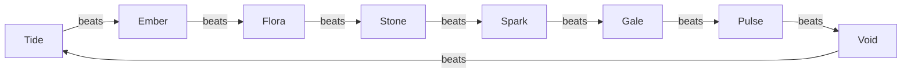

# Types

> Generated from the game code by `tools/gen_wiki.c`. Don't edit by hand: run the tool again after changing types.

Every echoid has one of **8 types**, and so does every move. Types decide how much damage a move does: a move of the right type does double damage, and the wrong type does half.

See also: [Types and Moves](Types-and-Moves.md) for every move and learnset.

## Contents

- [The type cycle](#the-type-cycle)
- [The types](#the-types)
- [Names](#names)
- [The type matchup chart](#the-type-matchup-chart)
- [Strengths and weaknesses by type](#strengths-and-weaknesses-by-type)
- [Quick reference: what to use against each type](#quick-reference-what-to-use-against-each-type)
- [Types and learning moves](#types-and-learning-moves)
- [Battle tips](#battle-tips)
- [Where an echoid's type comes from](#where-an-echoids-type-comes-from)

## The type cycle

The types form one loop. **Each type beats the next one**, and is beaten by the one before it:

In text: **Tide → Ember → Flora → Stone → Spark → Gale → Pulse → Void → Tide**

The reasoning behind each link:

- **Tide beats Ember**: water douses fire.
- **Ember beats Flora**: fire burns plants.
- **Flora beats Stone**: roots crack rock.
- **Stone beats Spark**: rock and earth ground electricity.
- **Spark beats Gale**: lightning splits the wind.
- **Gale beats Pulse**: wind scatters and drowns out sound.
- **Pulse beats Void**: a signal cuts through the emptiness.
- **Void beats Tide**: the abyss swallows the sea.

Because it's a single loop, every type has exactly **one type it beats**, **one type it's weak to**, and is neutral against the other 5.

## The types

| Type | Short name | About | Species |
|---|---|---|---|
| **Tide** | `TID` | Water and currents. Tide echoids are often found on networks near the sea... or the kitchen sink. | Drizlet, Wavern, Abyssurge |
| **Ember** | `EMB` | Fire and heat. Fast-burning and aggressive. | Cindrop, Flarix, Pyrovane |
| **Flora** | `FLO` | Plants, roots and growth. Patient, and tougher than they look. | Sproutle, Thornet, Verdarch |
| **Stone** | `STN` | Earth, rock and metal. Slow to move and hard to move. | Pebblit, Graniton, Monolux |
| **Spark** | `SPK` | Electricity and lightning. The native element of every access point. | Zaplet, Voltusk, Arcwyrm |
| **Gale** | `GAL` | Wind and air. Quick, light and hard to pin down. | Breezel, Cyclark, Tempestra |
| **Pulse** | `PLS` | Sound, signals and radio waves. The echo in "echoid". | Pingle, Beaconix, Resonaut |
| **Void** | `VOI` | Shadow and emptiness. What's left between the signals. | Nullpup, Shadebit, Eclipson |

The short name is what the Flipper's screens show (for example in the Collect list and the move picker). Each type has three species; rarer echoids are more likely to be the later, stronger-looking species.

## Names

Besides its species, every echoid has **its own name**, generated from its MAC address by a Markov chain. The chain builds the name a letter at a time, choosing each letter from what follows the previous two letters in a list of words themed after the echoid's type. Names are 4 to 9 letters long and never just copy a word from the list. The same MAC always gives the same name.

| Type | Source words (sample) | Example names |
|---|---|---|
| **Tide** | marina, coral, brine, lagoon, nautil, ripple, … | Rizzlet, Pelagoo, Saline, Rippa, Sundristu, Kelago |
| **Ember** | cinder, blaze, ashen, pyra, scorch, kindle, … | Vulfulfla, Caldemaze, Cindle, Torcalder, Flameashe, Smolamel |
| **Flora** | fern, bramble, willow, thistle, sorrel, clover, … | Sorel, Acaurel, Verben, Sordal, Orclowaur, Bran |
| **Stone** | granite, basalt, shale, flint, obsid, quarry, … | Mont, Oranith, Obble, Flomare, Ferrbble, Garroble |
| **Spark** | volta, ampere, ion, tesla, arc, static, … | Plasmint, Quara, Famppar, Aradynamo, Volt, Kineutrad |
| **Gale** | zephyr, sirocco, mistral, cirrus, gust, aeris, … | Aeriswind, Gustoft, Swiflo, Stral, Plural, Sist |
| **Pulse** | echo, sonar, radar, beacon, hertz, chirp, … | Tona, Resodeson, Octatic, Cadal, Anteala, Rhade |
| **Void** | umbra, nyx, shade, null, eclipse, noctis, … | Veneth, Dimurk, Glow, Erebra, Noctrebus, Vesia |

## The type matchup chart

Find the **move's type** on the left and the **defending echoid's type** along the top. The cell is the damage multiplier.

| Move ↓ / Defender → | TID | EMB | FLO | STN | SPK | GAL | PLS | VOI |
|---|:---:|:---:|:---:|:---:|:---:|:---:|:---:|:---:|
| **Tide** | · | **2×** | · | · | · | · | · | ½ |
| **Ember** | ½ | · | **2×** | · | · | · | · | · |
| **Flora** | · | ½ | · | **2×** | · | · | · | · |
| **Stone** | · | · | ½ | · | **2×** | · | · | · |
| **Spark** | · | · | · | ½ | · | **2×** | · | · |
| **Gale** | · | · | · | · | ½ | · | **2×** | · |
| **Pulse** | · | · | · | · | · | ½ | · | **2×** |
| **Void** | **2×** | · | · | · | · | · | ½ | · |

**2×** = super effective (double damage) · **½** = not very effective (half damage) · **·** = normal damage

Things to know:

- **Only the move's type and the defender's type matter.** The attacker's own type doesn't change damage, so a Tide echoid using a Pulse move hits exactly like a Pulse echoid would.
- **A type is neutral against itself.** Tide moves do normal damage to Tide echoids.
- **Every move has a type**, so every attack in the game uses this chart.
- In battle, the move picker shows `x2` or `x.5` next to a move when it's super effective or not very effective against the echoid you're fighting, and the battle log adds `x2!` or `x.5` to the damage.

## Strengths and weaknesses by type

| Type | Its moves do 2× to | Its moves do ½ to | Takes 2× from | Takes ½ from | Neutral (both ways) |
|---|---|---|---|---|---|
| **Tide** | Ember | Void | Void | Ember | Flora, Stone, Spark, Gale, Pulse, Tide (itself) |
| **Ember** | Flora | Tide | Tide | Flora | Stone, Spark, Gale, Pulse, Void, Ember (itself) |
| **Flora** | Stone | Ember | Ember | Stone | Tide, Spark, Gale, Pulse, Void, Flora (itself) |
| **Stone** | Spark | Flora | Flora | Spark | Tide, Ember, Gale, Pulse, Void, Stone (itself) |
| **Spark** | Gale | Stone | Stone | Gale | Tide, Ember, Flora, Pulse, Void, Spark (itself) |
| **Gale** | Pulse | Spark | Spark | Pulse | Tide, Ember, Flora, Stone, Void, Gale (itself) |
| **Pulse** | Void | Gale | Gale | Void | Tide, Ember, Flora, Stone, Spark, Pulse (itself) |
| **Void** | Tide | Pulse | Pulse | Tide | Ember, Flora, Stone, Spark, Gale, Void (itself) |

Notice the symmetry: a type's moves are weak against the very type that beats it, and it shrugs off moves from the type it beats. For example Tide moves do only half damage to Void (which beats Tide), and Ember moves do only half damage to Tide.

## Quick reference: what to use against each type

| Facing a… | Attack with… | Avoid attacking with… | Its moves will hurt… |
|---|---|---|---|
| **Tide** | Void moves (2×) | Ember moves (½) | Ember echoids (2×) |
| **Ember** | Tide moves (2×) | Flora moves (½) | Flora echoids (2×) |
| **Flora** | Ember moves (2×) | Stone moves (½) | Stone echoids (2×) |
| **Stone** | Flora moves (2×) | Spark moves (½) | Spark echoids (2×) |
| **Spark** | Stone moves (2×) | Gale moves (½) | Gale echoids (2×) |
| **Gale** | Spark moves (2×) | Pulse moves (½) | Pulse echoids (2×) |
| **Pulse** | Gale moves (2×) | Void moves (½) | Void echoids (2×) |
| **Void** | Pulse moves (2×) | Tide moves (½) | Tide echoids (2×) |

## Types and learning moves

An echoid can **never** learn moves of its two *opposed* types: the type it beats and the type that beats it. Everything else is possible, but each species only learns the moves in its own learnset.

| Type | Can never learn |
|---|---|
| Tide | Ember or Void moves |
| Ember | Flora or Tide moves |
| Flora | Stone or Ember moves |
| Stone | Spark or Flora moves |
| Spark | Gale or Stone moves |
| Gale | Pulse or Spark moves |
| Pulse | Void or Gale moves |
| Void | Tide or Pulse moves |

Most of an echoid's moves are its own type. On top of that, every echoid learns **counter moves**, of the type that beats whatever beats it (for example Tide is beaten by Void, Void is beaten by Pulse, so Tide echoids learn Pulse moves). They also learn a **species move** whose type depends on the species. So your echoid usually has an answer to the type that threatens it. Full learnsets: [Types and Moves](Types-and-Moves.md).

## Battle tips

- **Check the Collect panel before you fight.** It shows the wild echoid's type, so you know which of your moves will be `x2`.
- **Use your counter moves.** If a wild echoid's type beats yours, your counter move is probably super effective against it.
- **Switch when you're outmatched.** Use **Swap** to send in a team member whose moves beat the wild echoid. Switching costs your turn, so the wild echoid gets an attack on the newcomer.
- **Wild echoids play the chart too.** They usually pick their most damaging move against your echoid, so expect super effective hits if their type beats yours.
- **Build a mixed team.** With up to 6 echoids in your team, covering several types means you'll always have someone to switch to.

## Where an echoid's type comes from

An echoid's type, like its species, rarity and stats, is worked out from a MAC address, so it never changes. Wild echoids come from the MAC address (BSSID) of a WiFi access point, and your starter comes from your Flipper's own Bluetooth MAC. The same access point is always the same echoid, with the same type. All 8 types are equally common.
